# Gestion des incidents de sécurité

Application full-stack de gestion des incidents de sécurité informatique, réalisée dans le cadre du devoir Spring Security, JWT et React.

## Projets

- `backend/` — API Spring Boot 3, Java 17, Spring Web, Spring Security, Spring Data JPA, Validation, H2 et JJWT. Port par défaut : `8080`.
- `frontend/` — React, Vite, Axios et React Router. Port de développement : `5173`.

## Modèle de données

Le backend comprend les entités `User`, `Incident` et `IncidentHistory`, ainsi que les dépôts JPA et les énumérations des rôles, catégories, priorités et statuts. Chaque incident est lié à son créateur et, éventuellement, au technicien auquel il est affecté. L’historique conserve les changements de statut et les notes de traitement. Le diagramme ERD et les choix de relations sont disponibles dans [docs/erd.md](docs/erd.md).

## Authentification et sécurité

Les requêtes et réponses utilisent JSON. L’inscription attribue automatiquement le rôle `EMPLOYEE` ; le client ne peut pas choisir son rôle. Les mots de passe sont hachés avec BCrypt. Les sessions Spring Security sont sans état (stateless). Le CORS autorise le frontend à `http://localhost:5173`.

| Méthode | Point de terminaison | Résultat attendu |
|---|---|---|
| `POST` | `http://localhost:8080/auth/register` | `201 Created` |
| `POST` | `http://localhost:8080/auth/login` | `200 OK` |

### Inscription — `/auth/register`

```json
{
  "fullName": "Amina Exemple",
  "email": "amina@example.com",
  "password": "ChangeMe123!"
}
```

### Connexion — `/auth/login`

```json
{
  "email": "amina@example.com",
  "password": "ChangeMe123!"
}
```

Une authentification réussie renvoie `token`, `tokenType`, `email`, `fullName`, `role`, `issuedAt` et `expiresAt`. Le JWT est valide une heure par défaut. Pour appeler une route protégée, transmettre l’en-tête :

```http
Authorization: Bearer <token>
```

Le secret JWT doit être configuré dans la variable d’environnement `JWT_SECRET` avec au moins 32 octets UTF-8 avant tout déploiement. La valeur de secours incluse dans la configuration est réservée au développement local. Pour le moment, `/auth/**` et `/h2-console/**` sont publics ; les routes `/api/**` requièrent un JWT valide.

## Captures d’écran Postman

### Inscription réussie — `201 Created`

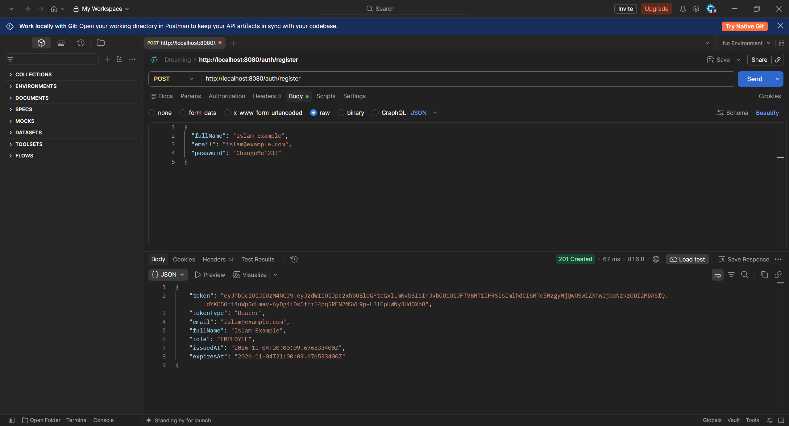

### Connexion réussie — `200 OK`

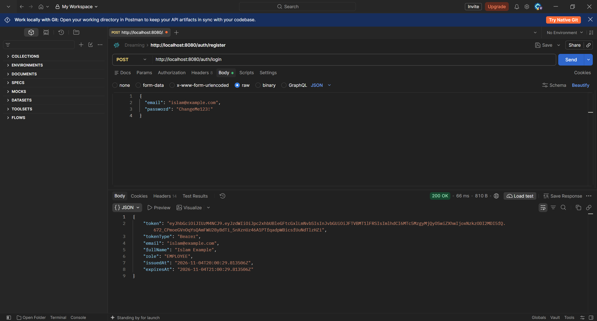

## Lancement du projet

### Backend

Prérequis : Java 17 ou supérieur et Maven.

```powershell
cd backend
mvn spring-boot:run
```

L’API est disponible sur `http://localhost:8080`.

### Frontend

Prérequis : Node.js et npm.

```powershell
cd frontend
npm install
npm run dev
```

Vite affiche l’adresse locale du frontend, normalement `http://localhost:5173`.

## État actuel

L’initialisation des deux projets, le modèle de données, le diagramme ERD et l’authentification JWT sont en place. Les API métier, les règles d’autorisation par rôle et les écrans fonctionnels du frontend restent à développer.

## API de profil et des incidents

Toutes les routes `/api/**` exigent `Authorization: Bearer <token>`.

| Méthode | URL | Accès |
|---|---|---|
| `GET` | `/api/profile` | Utilisateur connecté |
| `PUT` | `/api/profile` | Utilisateur connecté |
| `POST` | `/api/incidents` | Utilisateur connecté (créateur = compte connecté) |
| `GET` | `/api/incidents/my` | Ses incidents créés |
| `GET` | `/api/incidents/{id}` | Créateur, technicien affecté ou administrateur |
| `GET` | `/api/incidents/assigned` | Technicien |
| `PUT` | `/api/incidents/{id}/status` | Technicien affecté à l’incident |
| `GET` | `/api/incidents` | Administrateur |
| `PUT` | `/api/incidents/{id}/assign/{technicianId}` | Administrateur |

Création d’incident (`POST /api/incidents`) :

```json
{
  "title": "Suspicion de phishing",
  "description": "Un courriel suspect a été reçu.",
  "category": "PHISHING",
  "priority": "HIGH"
}
```

Mise à jour du statut (`PUT /api/incidents/{id}/status`) :

```json
{
  "status": "IN_PROGRESS",
  "treatmentNote": "Analyse des en-têtes du courriel en cours."
}
```

Les rôles et l’accès à chaque incident sont contrôlés par le backend. Les employés ne peuvent lire que leurs incidents ; les techniciens ne peuvent traiter que les incidents qui leur sont affectés. Les incidents `CLOSED` ne peuvent pas être rouverts par la mise à jour technicien.

### Création réussie d’un incident — `201 Created`

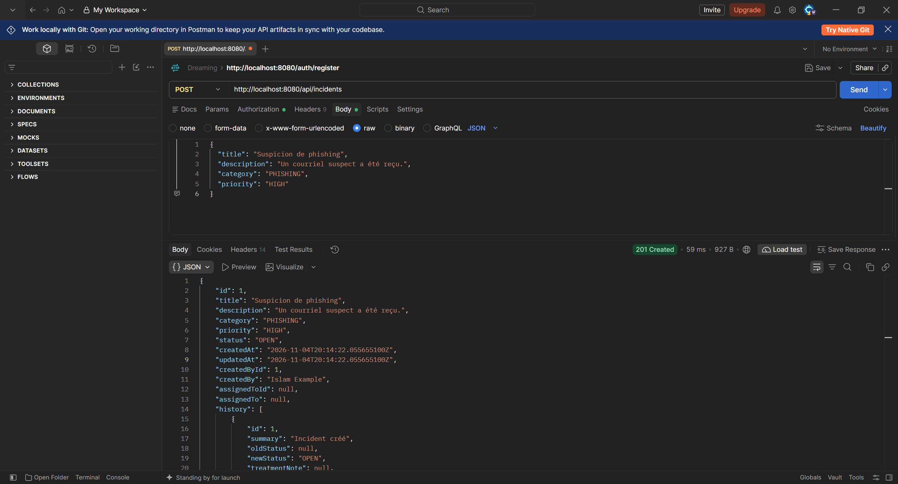

### Consultation des incidents de l’utilisateur — `200 OK`

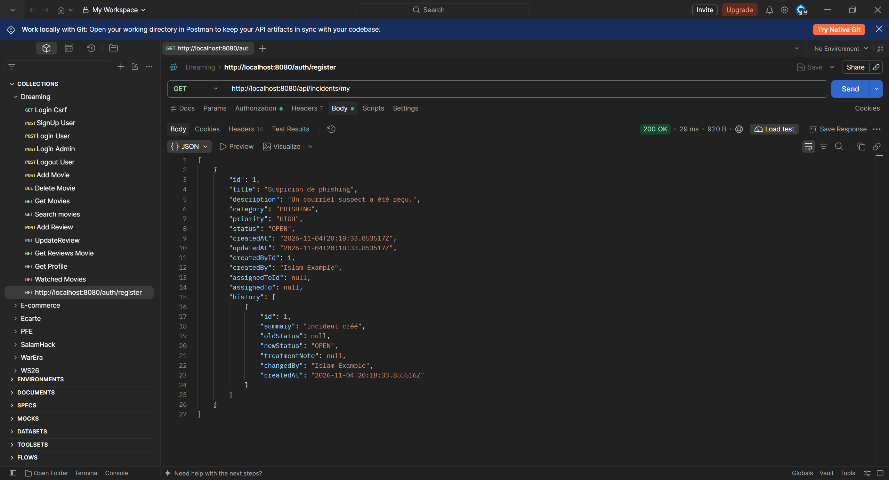

### Consultation du détail d’un incident — `200 OK`

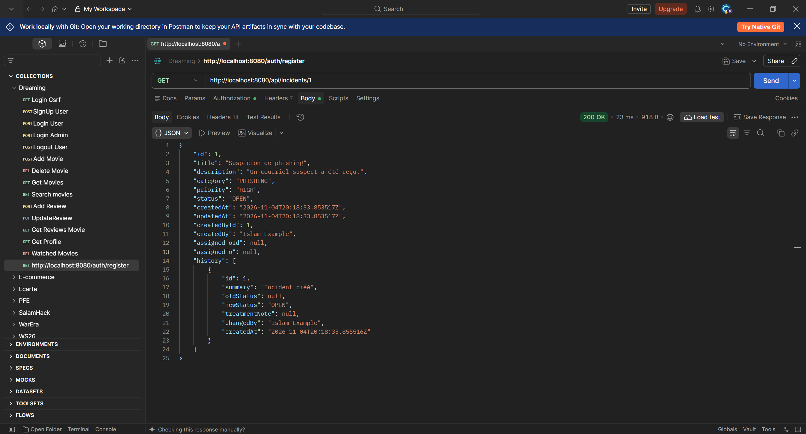

### Connexion du second employé — `200 OK`

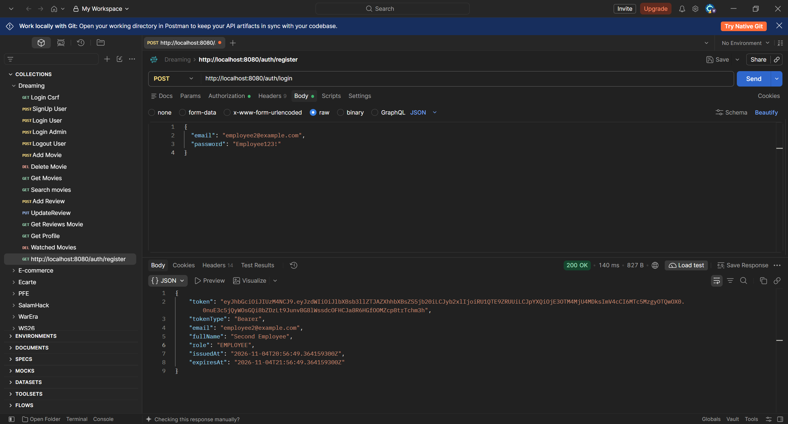

### Contrôle de propriété : accès refusé au second employé — `403 Forbidden`

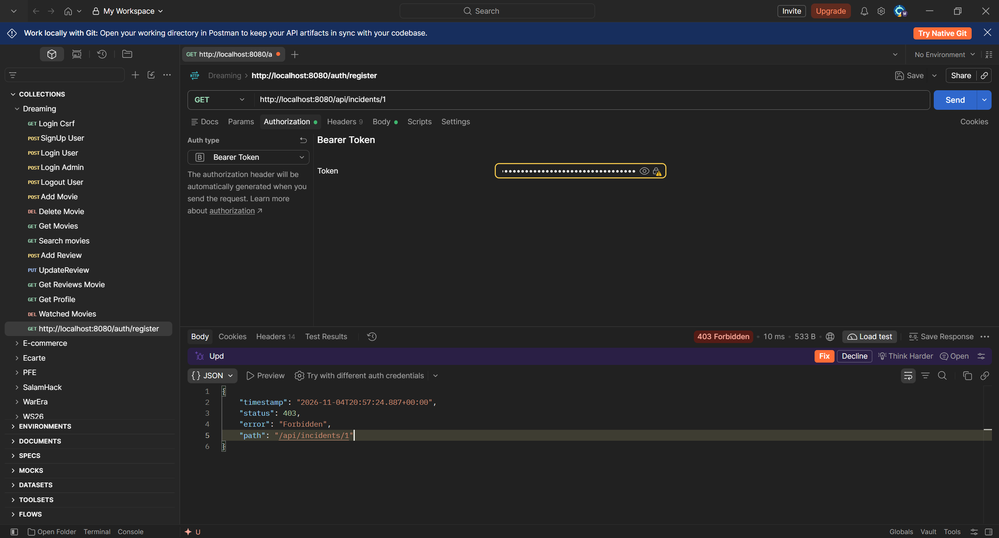

## Administration des utilisateurs et statistiques

Le premier compte administrateur est créé au démarrage uniquement lorsque les deux variables d’environnement `BOOTSTRAP_ADMIN_EMAIL` et `BOOTSTRAP_ADMIN_PASSWORD` sont définies. Il n’est jamais possible de choisir le rôle lors d’une inscription publique. Le mot de passe initial est haché avec BCrypt. Une fois connecté comme administrateur, celui-ci peut attribuer le rôle `TECHNICIAN` ou désactiver un compte.

Exemple PowerShell pour démarrer avec un administrateur initial :

```powershell
$env:BOOTSTRAP_ADMIN_EMAIL = "admin@example.com"
$env:BOOTSTRAP_ADMIN_PASSWORD = "ChangeThisAdminPassword!"
cd backend
mvn spring-boot:run
```

| Méthode | URL | Accès |
|---|---|---|
| `GET` | `/api/admin/users` | Administrateur |
| `PUT` | `/api/admin/users/{id}/role` | Administrateur |
| `PUT` | `/api/admin/users/{id}/enabled` | Administrateur |
| `GET` | `/api/admin/statistics` | Administrateur |

Exemple pour promouvoir un utilisateur au rôle technicien :

```http
PUT /api/admin/users/2/role
Authorization: Bearer <token-administrateur>
Content-Type: application/json
```

```json
{ "role": "TECHNICIAN" }
```

Exemple d’activation ou désactivation d’un compte :

```json
{ "enabled": false }
```

L’administrateur ne peut pas se désactiver lui-même ni retirer son propre rôle. Le tableau de bord des statistiques renvoie le nombre total d’utilisateurs, d’incidents et le nombre d’incidents pour chaque statut.

### Statistiques administrateur — `200 OK`

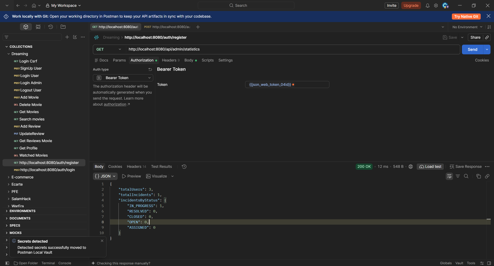

### Résolution d’un incident par le technicien — `200 OK`

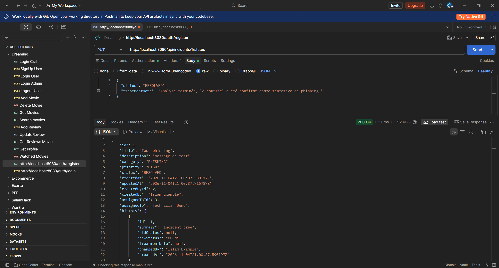

### L’employé consulte l’incident résolu et son historique — `200 OK`

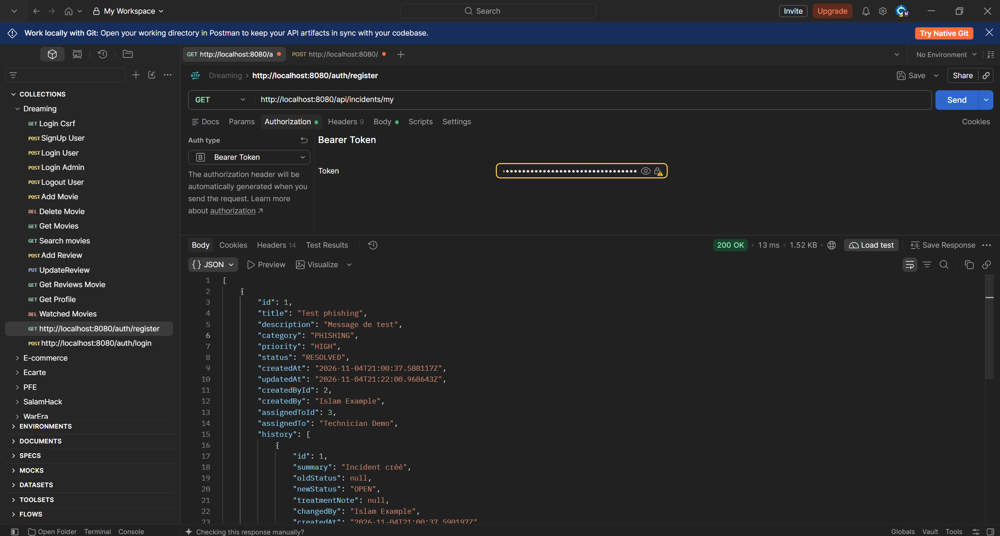

## Interface React

Le frontend React est connecté à l’API avec Axios. Le jeton JWT est ajouté automatiquement aux requêtes protégées ; une réponse `401` efface la session et redirige vers la connexion. Les écrans sont protégés selon le rôle côté client, tandis que le backend reste responsable de l’autorisation réelle.

Écrans disponibles :

- Connexion et inscription (nouvelle inscription = rôle `EMPLOYEE`).
- Tableau de bord adapté au rôle.
- Profil utilisateur.
- Liste des incidents créés, création d’un signalement et détail avec historique.
- File des incidents affectés et mise à jour du statut avec note de traitement pour le technicien.
- Liste complète des incidents, affectation à un technicien, gestion des utilisateurs et statistiques pour l’administrateur.

L’interface doit être ouverte sur `http://localhost:5173` afin de correspondre à l’origine autorisée par le CORS du backend.

```powershell
cd frontend
npm install
npm run dev
```

Vérifier la compilation de production :

```powershell
npm run build
```

L’URL de l’API peut être remplacée avec la variable Vite `VITE_API_URL` ; par défaut, `http://localhost:8080` est utilisé.

## Captures d’écran de l’interface

### Tableau de bord de l’employé

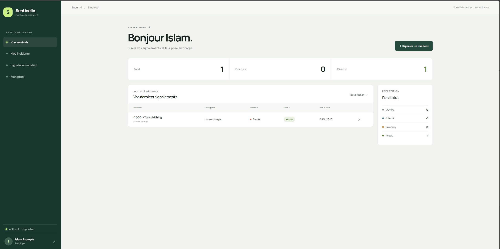
