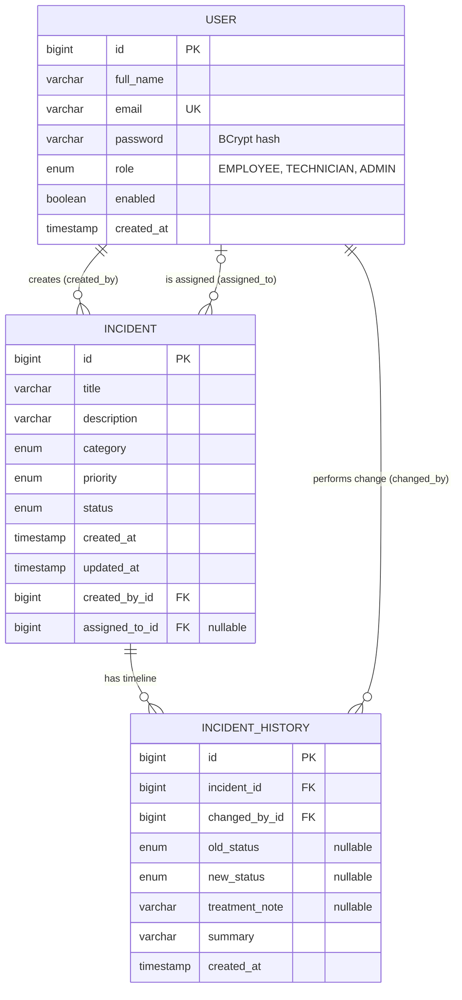

# ERD — Security Incident Management

## Relationship and loading choices

- Each incident has exactly one creator and optionally one assigned technician. Both are `@ManyToOne(fetch = LAZY)`; the nullable assignment permits an unassigned incident.
- A user can create and be assigned many incidents (`@OneToMany`, lazy collections). The two user relationships use distinct foreign keys.
- Each timeline entry belongs to one incident and records the user who performed the action. Status fields are nullable so the same timeline can also represent assignment or a treatment note without a status transition.
- `EnumType.STRING` keeps roles, categories, priorities, and statuses readable and stable in the database. History entries are ordered by creation time.
- Lazy loading avoids fetching whole user/incident graphs for routine queries; API response DTOs should explicitly select the fields to expose and prevent recursive entity serialization.
